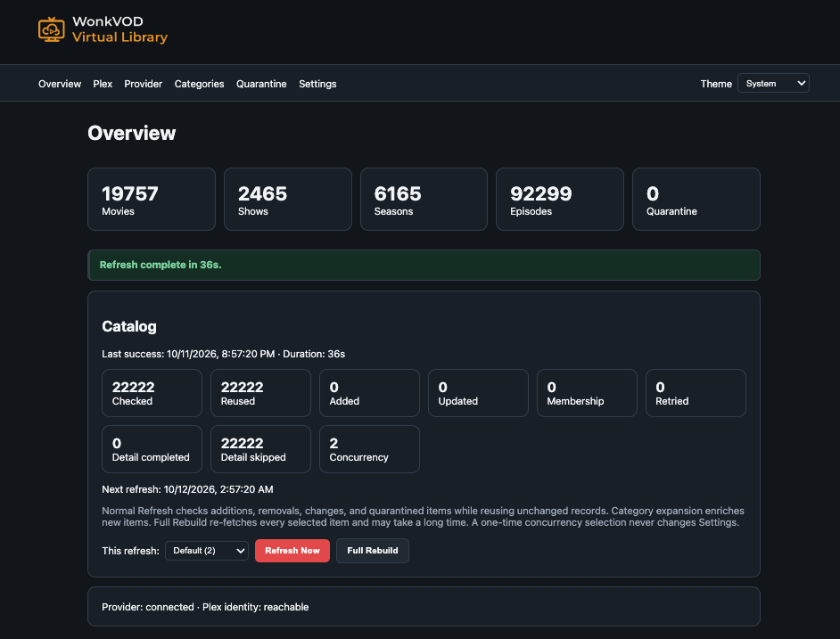
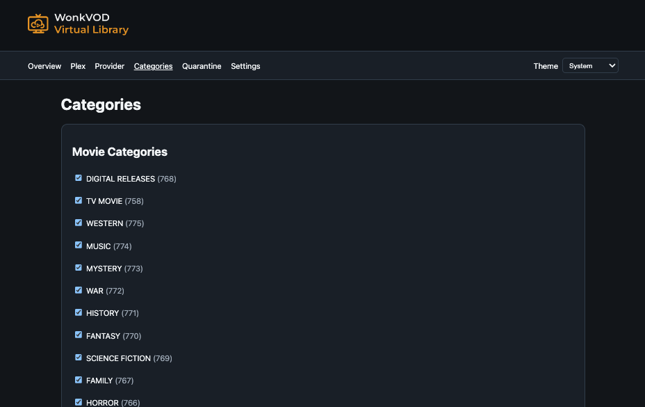
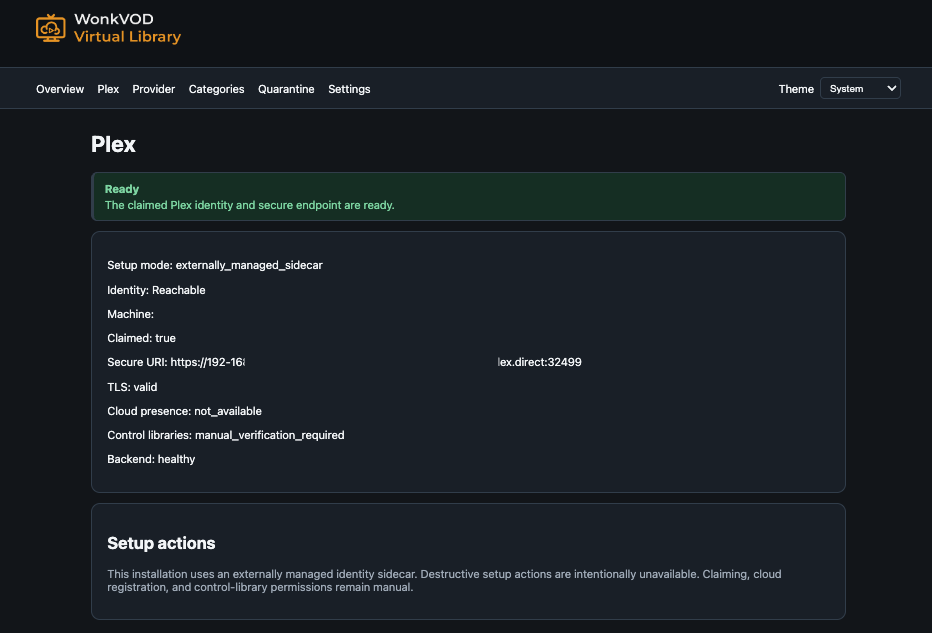
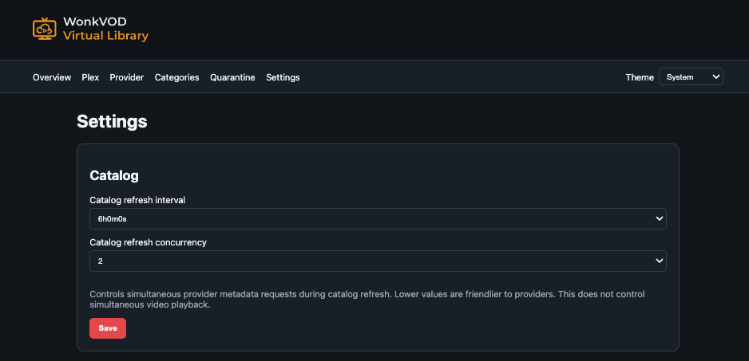

# WonkVOD

WonkVOD turns an Xtream-compatible video-on-demand source into virtual Movie
and TV libraries that stock Plex clients can browse and Direct Play. It builds
a source-neutral canonical catalog, projects that catalog through a
Plex-compatible HTTP adapter, and streams source media bytes only when a client
asks for them.

WonkVOD does not ingest local media, run Plex scanners or analyzers, modify a
Plex database, or mount a synthetic filesystem. `catalog.json` is the current
persisted canonical catalog.

```text
Xtream
   |
Source Adapter
   |
Canonical WonkVOD Catalog (catalog.json)
   |
+----------+----------+
|                     |
Plex Adapter      Future adapters
|
plex-identity / TLS compatibility
|
Stock Plex Clients
```

## Why It Exists

Large remote VOD catalogs do not naturally fit Plex's local-file ingestion
model. Importing placeholder files, waiting for scans, and maintaining a second
Plex database creates slow synchronization and fragile state. WonkVOD keeps one
canonical metadata snapshot, applies cheap incremental provider updates, and
answers Plex browse and playback requests directly. Production Plex libraries
do not need to rescan when WonkVOD refreshes.

## What WonkVOD Is Not

WonkVOD is not:

- a live-TV proxy such as Threadfin or xTeVe;
- a DVR;
- a transcoder or remuxer;
- a local-media importer;
- a Tunarr-style virtual linear channel generator; or
- a replacement for Plex clients or a production Plex Media Server.

Media is offered for Direct Play. Actual playback depends on the container,
video, audio, and subtitle support of the selected Plex client.

## Architecture

### WonkVOD backend

The non-root, read-only backend container owns the Web Setup service, canonical
catalog, Plex-compatible virtual libraries, metadata projection, play queues,
and byte-range media proxy. Its plain Plex-compatible listener is reachable
only from the private Compose network.

### Canonical catalog

`catalog.json` is an atomically promoted, source-neutral snapshot. Objects have
stable identities and may belong to multiple categories. Immutable indexes make
full-scale browsing inexpensive. Provider credentials and operator choices live
separately in `config.json`; media bytes are never persisted.

### Plex adapter

The adapter projects the catalog as virtual Movie and TV sections and implements
the response contracts needed by supported stock Plex clients. Refreshing this
projection does not trigger production PMS scans or alter a Plex SQLite database.
Movie and show title search uses an in-memory index from the same immutable
catalog generation; it never queries the provider or performs media inspection.

### plex-identity sidecar

A small, claimed, official PMS supplies the Plex machine identity, cloud
presence, managed-home library entitlements, and a Plex-managed `plex.direct`
certificate. Its tiny control libraries do not contain the WonkVOD catalog or
media. Provisioning this sidecar is currently manual.

### TLS terminator

`wonkvod-tls` reads the sidecar's PKCS#12 certificate and Preferences file
read-only, decodes key material in memory, reloads renewed certificates, and
proxies HTTPS port 32499 to the private backend. No extracted private key is
written to ordinary persistent storage.

### Production Plex independence

The sidecar and WonkVOD are independent of a household's production PMS. They
have separate identity, state, containers, and libraries. WonkVOD activity must
not restart or mutate production Plex.

## Requirements

- A Linux host with Docker Engine and Docker Compose v2.
- A Plex account able to claim the identity sidecar.
- An Xtream-compatible source that exposes Movie and/or Series VOD APIs.
- DNS/network access to the source, Plex services, and intended LAN clients.
- Persistent storage for WonkVOD state and the identity PMS configuration.
- CPU/RAM appropriate to the selected catalog and refresh concurrency. There is
  no universal minimum; playback is streamed and no media-size local disk is
  required.

## Quick Start

1. Clone the repository into `/opt/wonkvod`.
2. Copy `deploy/.env.example` to the ignored `deploy/.env` and fill in only
   installation-specific values.
3. Create the runtime state directory and protected provider bootstrap file.
4. Provision and claim the `plex-identity` sidecar; create its two control
   libraries and wait for its certificate.
5. Run `./deploy/deploy.sh deploy`.
6. Read the one-time Web Setup token from the local backend logs and establish
   the administrator password at `/setup`.
7. Configure the provider, select categories, and run a normal refresh.
8. Grant the two sidecar library entitlements to Plex Home users as needed.
9. Open WonkVOD from a supported Plex client and test compatible media.

## Detailed Installation

### 1. Install the source and create state

```sh
sudo git clone <repository-url> /opt/wonkvod
sudo install -d -m 0750 -o 65532 -g 65532 /opt/wonkvod-runtime/state
sudo install -m 0600 -o root -g root /dev/null /opt/wonkvod-runtime/xtream.env
cd /opt/wonkvod
cp deploy/.env.example deploy/.env
chmod 0600 deploy/.env
```

UID/GID `65532` matches the default backend image. If the deployment is changed
to another runtime user, give that user ownership of the state directory.

Put bootstrap provider values in `/opt/wonkvod-runtime/xtream.env`:

```text
WONKVOD_XTREAM_URL=https://provider.example
WONKVOD_XTREAM_USER=replace-me
WONKVOD_XTREAM_PASS=replace-me
```

This file seeds missing configuration. The Web UI later persists settings to
`config.json`; neither file belongs in Git.

### 2. Configure deployment variables

Edit `deploy/.env`. Set the sidecar-issued `plex.direct` hostname and URI, the
sidecar machine identifier, persistent paths, Docker network, and desired host
ports. Web Setup defaults to `127.0.0.1:32501`; bind it to a trusted LAN address
only when direct LAN access is intended.

Validate without changing containers:

```sh
./deploy/deploy.sh config
```

### 3. Provision the Plex identity sidecar

Create a separately managed official `plexinc/pms-docker` container with:

- persistent `/config` storage (the reference installation uses
  `/opt/plex-identity/config`);
- a stable friendly name such as `WonkVOD`;
- a short-lived claim token supplied only during claiming;
- an external Docker network named in `PLEX_IDENTITY_NETWORK`; and
- `ADVERTISE_IP` set to the WonkVOD endpoint, for example
  `http://LAN-IP:32499/`.

Wait until PMS is claimed, its machine identifier is stable, and
`Cache/cert-v2.p12` exists. Use supported Plex library APIs to create one tiny
Movie control library named `WonkVOD Movies` and one tiny TV control library
named `WonkVOD TV Shows`. Each may contain a harmless local control fixture.
These sections establish Plex library entitlements; WonkVOD serves the actual
virtual catalog. Grant them to managed users through Plex Home. Do not commit
claim tokens, account tokens, `Preferences.xml`, or certificate material.

Copy the resulting hostname, secure URI, and machine identifier into the local
`deploy/.env`. Point its certificate/config paths at the persisted sidecar.
Detailed lifecycle and safety constraints are in
[`docs/PLEX_SETUP.md`](docs/PLEX_SETUP.md).

### 4. Deploy and establish Web authentication

```sh
./deploy/deploy.sh deploy
docker logs wonkvod-backend 2>&1 | grep 'one-time setup token'
```

Keep that command and its output local. Open `http://HOST:32501/setup`, enter
the token, and choose a password of at least 12 characters. The raw token is
never persisted and becomes permanently invalid after successful setup.

### 5. Configure the catalog

On **Provider**, test and save the source connection. On **Categories**, choose
Movie and TV categories and preview their impact. On **Settings**, select the
steady-state refresh interval and conservative provider concurrency. Run
**Refresh Now**. The old snapshot remains live until the complete candidate is
saved and promoted atomically.

## First Run

- **Setup/Login** establishes the one administrator password and later creates
  a 12-hour authenticated browser session.
- **Overview** shows health, counts, refresh state, and recent outcomes.
- **Plex** reports the externally managed identity/TLS state. A ready system
  needs no setup action.
- **Provider** tests and saves credentials without returning the saved password.
- **Categories** previews and applies Movie/TV selections.
- **Quarantine** displays sanitized item failures and bounded retry actions.
- **Settings** controls refresh timing/concurrency and changes the administrator
  password.

### Web Setup screenshots

| Overview | Categories |
|---|---|
| [](docs/WonkVOD_Overview.png) | [](docs/WonkVOD_Categories.png) |

| Plex status | Settings |
|---|---|
| [](docs/WonkVOD_Plex.png) | [](docs/WonkVOD_Settings.png) |

These screenshots show the core pre-release pages used to validate the catalog
and sidecar. WonkVOD 1.0 adds Login/Logout, a version footer, password rotation,
and the simplified ready-state Plex message described above.

## Catalog Refresh

### Normal Refresh

Normal refresh uses provider bulk lists, computes a local diff, reuses unchanged
canonical objects, enriches only new or changed objects, retries quarantined
items, and atomically promotes the result. With a stable source it normally
finishes in seconds.

### Category Expansion

Adding categories may require one-time detail enrichment for many new objects.
Preview reports the estimated impact. A temporary concurrency override may be
useful, but high concurrency can trigger provider throttling and never changes
the saved steady-state value.

### Full Rebuild

Full Rebuild deliberately refetches details for every selected item. It is an
expensive maintenance/recovery action, not a normal update and not selected
automatically after restart.

### Quarantine

Isolated malformed or transiently unavailable objects do not poison a complete
refresh. They enter quarantine with sanitized diagnostics. Retry uses the same
atomic incremental path at low concurrency; a failed retry leaves the live
catalog untouched.

## Performance / Scale

The reference installation has been exercised at roughly 20,000 movies, 2,500
shows, 6,000 seasons, and more than 90,000 episodes. Its persisted catalog is
measured in hundreds of megabytes rather than media-size storage, and stable
incremental refreshes complete in seconds. These are observed values, not
hardware or provider guarantees. Immutable indexes serve lists, paging,
categories, first-character filters, title search, metadata, and play queues
without provider work on the request path.

## Client Compatibility

Validated clients include Plex for Roku, Plex HTPC, Plex for Mac, and Plex for
iOS. The compatibility adapter preserves the paging, provider, navigation,
metadata, artwork, queue, decision, and range contracts used by those clients.
WonkVOD does not transcode: Direct Play still depends on each client's support
for the source container and codecs. A successful catalog entry does not imply
that every device can decode its media.

## Web Authentication

Web Setup uses a single administrator password. Passwords are hashed with
Argon2id and stored in `auth.json` mode `0600`; plaintext passwords and raw
sessions are not persisted. Sessions are random, in memory, expire after 12
hours, and are invalidated by restart. The session cookie is HttpOnly,
SameSite=Strict, and Secure when the UI itself is reached through HTTPS.
State-changing APIs require a per-session CSRF token. Login and setup attempts
have a small per-client rate limit.

Changing the password under **Settings** invalidates every session and creates a
replacement session for the current browser. There is no web recovery route. A
local administrator can stop only the backend, move `auth.json` to a protected
backup location, and start the backend. A new one-time token is then printed to
local logs. After establishing the replacement password and verifying access,
retain or securely destroy the old file according to local policy. Never edit a
password hash by hand.

Do not expose the plain HTTP Web port directly to the public Internet. Use a
trusted LAN, loopback plus an authenticated tunnel, or a separately hardened
HTTPS reverse proxy.

## Configuration

Mutable `config.json` contains the provider URL/credentials, enabled Movie/TV
category IDs, refresh interval, and steady-state refresh concurrency (`1`, `2`,
`4`, `6`, `8`, or `10`; default `2`). Environment variables in the protected
provider file bootstrap a missing config. Leaving the password blank in an
update preserves its current value.

`deploy/.env` contains installation paths and public endpoint identity. See
[`deploy/.env.example`](deploy/.env.example) for supported variables. Generated
runtime state and local environment files are ignored by Git.

## Persistent Data / Backup

Back up:

- `state/config.json` — provider configuration and operator choices;
- `state/auth.json` — the administrator password hash;
- `state/catalog.json` — the last promoted catalog and lazy MediaFacts;
- the entire persistent `plex-identity` config directory; and
- local ignored deployment/provider environment files.

The catalog is reproducible from the source, but retaining it gives immediate
startup and preserves inspected media facts. No media cache or spool needs
backup. Protect all backups because configuration and PMS state contain secrets.

## Ports

| Purpose | Default | Exposure |
|---|---:|---|
| Secure Plex-compatible endpoint | TCP 32499 | LAN via TLS terminator |
| Web Setup | TCP 32501 | loopback by default |
| Backend Plex listener | TCP 32499 | private Docker network only |
| Identity PMS admin endpoint | site-defined (reference: 33400 -> 32400) | trusted administration only |

Ports and bind addresses are configurable in ignored `deploy/.env`.

## Managed Plex Home Users

In Plex Home administration, grant a managed user access to both control
libraries on the WonkVOD identity server:

- `WonkVOD Movies`
- `WonkVOD TV Shows`

The permissions are sidecar entitlements; WonkVOD supplies the virtual content.
If a user sees the server but not a section, re-check both grants and allow Plex
clients time to refresh their cached resources. Do not recreate the identity to
fix an entitlement problem.

## Troubleshooting

- **Server does not appear:** verify the sidecar is claimed and present, its
  machine identifier matches `deploy/.env`, `ADVERTISE_IP` is correct, DNS
  resolves the `plex.direct` hostname to the LAN host, and TLS validates.
- **Claim/certificate is pending:** inspect the sidecar locally; do not delete
  its config or reclaim a working identity. Confirm `cert-v2.p12` exists and
  the TLS container can read it.
- **Categories saved but content is unchanged:** saving selection is separate
  from catalog promotion. Run normal Refresh Now and check its final status.
- **Refresh takes a long time:** category expansion enriches new objects; Full
  Rebuild refetches everything. A slow no-change incremental run instead points
  to provider/network latency or throttling.
- **Provider rejects concurrency:** reduce saved concurrency (default `2`) and
  retry. Temporary overrides do not change the saved value.
- **Quarantine has items:** inspect the sanitized class, correct a source issue
  if possible, then use low-concurrency retry. Healthy content remains live.
- **Playback reports codec/transcode failure:** the client cannot Direct Play
  the selected source stream. WonkVOD does not transcode or remux.
- **Client says server unavailable:** check the advertised secure URI, normal
  system trust validation, port 32499, sidecar presence, TLS/backend health, and
  LAN routing. Web Setup health alone does not validate Plex discovery.
- **Artwork intermittently fails:** verify provider artwork availability and
  retry later; WonkVOD serves/transforms artwork in memory and does not maintain
  a permanent image cache.
- **Cannot log in:** confirm the local clock, restart once to invalidate stale
  sessions, or use the documented local `auth.json` recovery procedure.
- **Unsure between refresh modes:** use normal Refresh Now. Reserve Full Rebuild
  for explicit deep revalidation or recovery.

## Updating

Fetch or check out a reviewed release in a clean worktree, read its release
notes, back up persistent state, and run:

```sh
./deploy/deploy.sh deploy
```

The script validates Compose, builds an image labelled with application version
and exact Git revision, replaces only the backend, and waits for health. It does
not restart the identity sidecar or production Plex. Keep the previous image as
the immediate rollback target.

## Uninstalling

Stop the `wonkvod` Compose project without deleting volumes or state, then
remove only WonkVOD containers/images after verifying no rollback is needed.
Delete runtime state and sidecar configuration only as a separate, deliberate
action after backups. Removing or reclaiming the sidecar changes Plex identity
and managed-user entitlements; it is not required merely to stop WonkVOD. Never
use a broad Docker prune on a shared host.

## Security

- Keep provider environment files, `config.json`, `auth.json`, Plex tokens,
  PMS preferences, certificates, and backups out of Git and mode-restricted.
- The backend runs non-root, read-only, without Linux capabilities; only the
  state bind is writable.
- Web Setup is authenticated but should remain on loopback or a trusted LAN.
- The TLS terminator reads PMS certificate material read-only and keeps decoded
  key material in memory.
- Review container images, ignored local configuration, and repository history
  before any public publication.

## License / Disclaimer

WonkVOD is licensed under the [MIT License](LICENSE).
Copyright (c) 2026 Evan Cash / WonkWorks.

WonkVOD is an independent, unofficial project. It is not affiliated with,
sponsored by, or endorsed by Plex. Plex and related trademarks belong to their
respective owner. Users are responsible for having lawful access to, and the
necessary rights for, every media source they configure.

## Architecture / Developer Docs

- [Web Setup and authentication](docs/WEB_SETUP.md)
- [Plex identity lifecycle](docs/PLEX_SETUP.md)
- [Plex search contract](docs/SEARCH.md)
- [Retired legacy architecture](docs/LEGACY_ARCHITECTURE.md)
- [Deployment and rollback](deploy/README.md)
